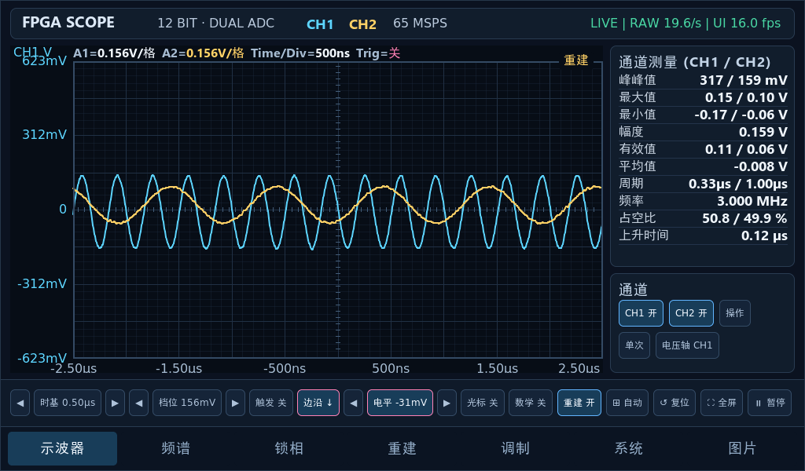

# 双通道信号采集与调制分析仪

本项目是一台基于 **Artix-7 FPGA** 与 **RK3506 Linux 触屏**的双通道信号分析仪。以双通道 12 位、65 MSPS 同步采集为基础，在 FPGA 内完成频谱、数字下变频、锁相及谐波功率处理，并通过触屏提供波形观察、参数测量与调制分析。仓库公开 FPGA RTL、屏端源码、协议和测试资料，便于复现与进一步开发。

> 2026 全国大学生嵌入式芯片与系统设计竞赛 · FPGA 创新设计赛道 · AMD 自主选题



## 三个重点

**1. 完整的 FPGA 信号处理链。** 双通道 12 位 65 MSPS 同步采集 → 多速率抽取 → 自研 4096 点共享 FFT（不调用 Xilinx FFT IP）→ DDC → 片上频率捕获与锁相 → H1–H5 谐波功率 → CRC32 成帧，全部在 XC7A35T 内完成。亮点不是"资源占得多"，而是这套共享计算结构如何在 20K LUT 里同时装下 FFT、DDC、锁相和谐波统计。

**2. 从波形测量走到信息分析。** 波形、频谱、相位与调制分析在同一块 7 英寸触屏上完成。读数与有效状态一起显示：锁相页没有激励时数值显示「—」并置为「相位变化超限」，调制页判决没做完时明确标「待判决」，不用旧值或漂亮曲线充数。

**3. 有证据的工程实现。** 真实信号发生器激励、实屏截图、RTL 仿真、资源时序报告与协议 CRC 校验互相对应，逐条可在[验证与证据](#验证与证据)里追溯；不能对应的结论不写。

## 能力一览（发布版本为七页）

| 页面 | 内容 |
|---|---|
| ⌁ 示波器 | 双通道时域波形：时基 / 档位 / 边沿触发 / 单次；通道测量峰峰值、最大值、最小值、有效值、平均值、周期、频率、占空比、上升时间 |
| ▥ 频谱 | FPGA SPEC 帧（4096 点共享 FFT，固定 Hann 窗）+ 屏端 RAW 1024 点谱（Hann / Blackman / FlatTop 可切）；中心频率、峰值电平、底噪、Δf、H1–H5 与 THD 2–5 |
| ◎ 锁相 | 片上锁相：I/Q 相位矢量与双通道波形同屏；参考频率、幅度、相位差、锁定状态 |
| ✧ 重建 | 原始样点 vs 带限插值重建，同一时间窗上下对齐；按波形类型决定是否重建 |
| ⚙ 调制 | DDC + 包络 / 频偏 / 星座：AM 调制度、2FSK 频偏与符号同步、OOK 位同步、BPSK 观测量 |
| ▤ 系统 | 渲染帧率、链路吞吐、丢包与 CRC 统计等板载实测值 |
| ▦ 图片 | 图像包流演示：OOK 曼彻斯特编码 256×128 包流，逐包校验后按行还原 |

> 「图片」页在发布版程序中存在（分支 `fpga-modulation-ui-20261026`），`main` 的 `src/` 目前是六页版本；两边的差异与提交号记在 [docs/VERSION.md](docs/VERSION.md)。页面与源码的对应关系以该文件为准。

## FPGA 侧

目标器件 **XC7A35T FGG484-2（Artix-7 35T）**，Vivado 2018.3 综合实现，**RTL 全部自研，没有调用 Xilinx FFT IP**。系统时钟 65 MHz（50 MHz 板载晶振经 MMCM ×39 ÷2 ÷15 生成；另一路 300° 相移作 ADC 前传时钟，对应 65 MSPS）。

| 能力 | 怎么做的 | 源码 |
|---|---|---|
| 双通道 12 位 65 MSPS 同步采集 | AD9238 两路在同一采样沿锁存，偏移二进制转二补码；两通道同一帧，不分时切换 | `fpga/rtl/ad9238_capture.v` |
| 自研 4096 点共享 FFT | 手写时分复用 radix-2 DIT 蝶形，每级右移 1 位（总归一化 1/N）；多通道串行复用同一套旋转因子表，只搜 1…N/2 | `fpga/rtl/fft_frame_4ch.v`、`fpga/rtl/twiddle_4096.mem` |
| 多速率抽取前端 | CIC + 可换系数 FIR（wide / narrow 多套 `.mem`），按信号稳定性自动换档 | `fpga/rtl/multirate_fft_frontend.v`、`fpga/rtl/meas_bw_ctrl.v` |
| DDC 数字下变频 | NCO 混频（Q15 sin/cos 表）+ CIC / FIR 抽取，AM、2FSK、BPSK、OOK 的基带都从这里出 | `fpga/rtl/ddc_nco_mixer.v`、`fpga/rtl/ddc_cic_decimator.v`、`fpga/rtl/ddc_fir_decimator.v` |
| 片上频率捕获 + 锁相 | 「FFT 粗估 → 精扫 → 锁定」三段式，**一份 bitstream 扫完 ~200 Hz…32.4 MHz**（搜索范围，边界未做标定），换载频不用重编 | `fpga/rtl/freq_scan_ctrl.v`、`fpga/rtl/local_afc_2ch.v`、`fpga/rtl/lockin_core_2ch.v` |
| 谐波与 THD | H1–H5 功率存表、log2 表转 dB、64 位整数开方算 THD 2–5 | `fpga/rtl/harmonic_power_store.v`、`fpga/rtl/isqrt_u64.v` |
| 成帧与链路 | 多路帧并行仲裁 + AB5 时序 + 逐帧 CRC32，2 Mbaud 8N1 发出 | `fpga/rtl/parallel_frame_arbiter.v`、`fpga/rtl/ab5_frame_sequencer.v`、`fpga/rtl/v32cap3_tx.v` |

**资源与时序**（`fpga/build_evidence/` 是原机报告，实现 ID `a222905e`，Routed 状态）

| 资源 | 占用 |
|---|---|
| Total LUTs | **20294**（Logic 20238 + LUTRAM 56） |
| 触发器 | 13111 |
| DSP48 | **80**（蝶形、混频、CIC 累加） |
| Block RAM | 32×RAMB36 + 8×RAMB18，36 块等效（样点缓存、旋转因子、系数表、波形 LUT） |
| 时序 | WNS **+0.172 ns**、WHS **+0.010 ns**，无 setup / hold 违例 |

**构建**：`fpga/build.tcl` 提供完整构建脚本（Vivado 批处理建工程 → 综合 → 实现 → 出 bit）。
仓库提供脚本不等于已在干净环境验收：**换机器完整重建尚未跑通验证**，详见 [fpga/README.md](fpga/README.md)。

## 数字调制：分清"画出来"和"判出来"

屏端对调制信号的呈现能力不同，分开列清楚，避免把波形显示当成协议解码：

| 制式 | 屏端显示 | 符号/bit 判决 | 实机验证 |
|---|---|---|---|
| AM | 包络 + 调制度（正弦拟合） | 不适用（模拟调制） | 2 MHz 载波、1 kHz 调制、深度 50 % → 屏上 50.0 % |
| FM / PM | 相位差换算频偏 / 相位 | 不适用（模拟调制） | 未单独做实机记录 |
| OOK | 包络（Q8 模长） | ● bit 同步（门限 L/H 0.3 / 18.0），输出 bits 序列 | 1 MHz 载波、1000 Bd、曼彻斯特、256×128 图像包流 |
| 2FSK | 相位差换算频偏 | ● bit 同步（门限 L/H −1390.7 / 684.2 Hz） | 1 MHz 载波、1000 Bd、相对频偏 1525.0 Hz |
| BPSK | 原始 I/Q 轨迹（**未做载波恢复**） | ○ 待判决 | EVM 0.060、CFO +132 Hz，判决状态「待判决」 |
| QPSK | — | 未在屏端实现（仅历史 PC 侧做过恢复试验，不等于屏端已实现） | 无屏端记录 |

## 性能与速率

采样率、链路帧率、绘制帧率是三件事，分开列，避免混用：

| 项目 | 数值 | 条件 / 来源 |
|---|---|---|
| ADC 采样率 | 65 MSPS × 2 通道，12 位，同一采样沿 | 硬件（AD9238 + FPGA 采集） |
| 有效采样率（抽取后） | 65 MSPS ÷ decimation，dec 取 1…32768 的 2 的幂 | 接收端支持范围，见"已知边界" |
| 串口链路 | 2 Mbaud 8N1，RAW 帧 4140 B / SPEC 帧 2096 B，逐帧 CRC32 | 协议 |
| 接收帧率 | 屏上实测约 19.6 帧/s（RAW 页面右上角 `LIVE RAW 19.6/s`） | 发布版本，2 Mbaud |
| 面板刷新 | 1024×600 @ 49 Hz | DRM 模式（PREFERRED） |
| 绘制帧率 | 约 9.9 FPS（六页版本，1024 点折线 × 2 通道） | 早期版本实测，**七页版本未复测** |

**65 MSPS 是 ADC 的采样率，不是送到 Linux 的样点速率。** 串口按帧发送：RAW 波形帧（1024 点，4140 B）、
SPEC 频谱帧（2096 B）、MEAS 测量帧（128 B）、ANA 调制帧（1076 B）、DDC 参数帧（72 B），
每帧独立 CRC32；两帧之间的样点不上传，所以"接收帧率 19.6 帧/s"与"采样率 65 MSPS"是两个不同层面的事实。

## 验证与证据

每条结论都对得上输入条件、结果和证据文件；**结论范围写清楚**，不把一种正确当成全部正确。

| 证据 | 输入条件 | 结果 | 结论范围 |
|---|---|---|---|
| `01-scope-dual.png` | 发生器 CH1 3 MHz/300 mVpp → 分析仪 CH1；CH2 1 MHz/150 mVpp → CH2；500 ns/div | 峰峰值 317 / 159 mV，频率 3.000 / 1.000 MHz | 双通道同帧采集与通道测量可用；**不含**幅值精度标定 |
| `02-scope-2mhz.png` | 2.000 MHz / 200 mVpp 正弦 | CH2 峰值 212 mV | 单通道实时响应 |
| `03/04/05-fft-*.png` | 2.000 MHz / 200 mVpp；RAW 1024 点；分别 Hann / Blackman / FlatTop | 峰值 −33.9 / −33.9 / −33.8 dBFS，底噪 −91.8 / −91.2 / −86.5 dBFS | 窗函数切换与峰值一致性（极差 0.1 dB）；**不是**绝对幅度校准 |
| `06-fft-harmonic.png` | 2 MHz 方波 / 200 mVpp，HARM ON | 峰值 −31.8 dBFS，THD 2–5 = 38.441 % | 相对功率统计；**未做失真溯源校准** |
| `07-lock.png` / `08-lock-open.png` | CH1/CH2 同接 2 MHz 正弦，发生器相位差 45° | −45.15°、锁定；关掉一路后数值转「—」、状态「相位变化超限」 | 相位差测量与失效提示有效；**不含**绝对相位标定 |
| `09-mod-am.png` | 2 MHz 载波、1 kHz 调制、深度 50 % | 调制度 50.0 %，包络峰峰 12 码 | 调制度估计（正弦拟合）在指定条件下成立 |
| `10-mod-2fsk.png` / `12-mod-ook.png` | 1 MHz 载波、1000 Bd | 2FSK 频偏 1525.0 Hz、bit 同步；OOK bit 同步、bits 序列 | 指定码率下的符号同步；**未做**全码率 / 全信噪比统计 |
| `11-mod-bpsk.png` | 1 MHz 载波、1000 Bd | EVM 0.060、CFO +132 Hz，判决「待判决」 | 观测量可用；**判决能力尚未完成** |
| `fpga/tests/` RTL 仿真 | tb_adc_parallel、local_afc_2ch、meas_bw_ctrl、fft_frame_4ch 等 | Vivado 时序波形 | 数字逻辑功能正确性；**不含**模拟前端与板级噪声 |
| `fpga/build_evidence/*.rpt` | 实现 `a222905e` | 20294 LUT / 80 DSP / WNS +0.172 ns | 该次实现的资源与时序；换代码或换工具版本需重测 |

**链路正确 ≠ 测量正确**：每帧 CRC32 通过只说明这帧数据完整到达，不证明幅度、相位或调制度准确。上面几列分开写就是这个原因。

## 快速开始

**交叉编译（Linux 主机，ARMv7 hard-float）**

```bash
# 依赖：cmake、ARM 交叉工具链、同级目录下的 LVGL 源码
./build.sh            # 增量编译
CLEAN=1 ./build.sh    # 全量重编
```

`build.sh` 用 `toolchain.cmake` 交叉编译，LVGL 目录可用 `LVGL_DIR=` 覆盖（默认 `../lvgl-release-v9.1`）。

**部署到板子**

```bash
./deploy.sh                 # 通过 adb 推送并运行
./deploy_net.sh             # 或走网络：推送 → 校验 md5 → 一致后才覆盖 → 重启
```

地址、账号、口令请按你们自己的板子环境配置，仓库不记录任何默认口令。

**运行**

```bash
waveform_demo --source uart          # 真实串口数据（默认 2 Mbaud 8N1）
waveform_demo --source demo          # 无板子时用合成信号看界面
```

## 已知边界

**使用条件**

- 板端需 root 运行（读 `/dev/input/event0` 注入触摸、直接写 DRM）。
- 单 connector / 单屏；官方 `lv_demo` 必须先停，否则会抢 DRM 与输入设备。
- 中文字体是界面字符的子集，改文案需重跑 `tools/gen_v32_fonts.py`，否则新字是方块。

**测量边界**

- **未做精密幅相与失真校准**：H1–H5、THD 只在指定输入下做过功能测试，不是可溯源的失真测量。
- **串口带宽是硬约束**：2 Mbaud 下每帧 RAW 4140 B / SPEC 2096 B，帧率由帧长决定；提高帧率要减帧长或提速。
- **抽取换时间窗，代价是带宽**：有效采样率 = 65 MSPS ÷ decimation，奈奎斯特随之下降到 65 MHz ÷ (2·dec)。接收端接受 1…32768 的 2 的幂，但**能接受不等于板上验证过**——深抽取档目前只为 AM 包络用过，低频极限未系统标定。
- **帧与帧不连续**：相邻两帧 `start_idx` 实测相差约 1.17×10⁷ 个样点（一帧才 4096），两帧之间丢掉了约 99.96 % 的采样，不能拼接。
- **带限重建不消除混叠**：只对带限信号成立；超过 32.5 MHz 的成分已经折叠进带内，插值无法还原；窗口边缘前后各 64 个样点没有完整支撑，自动退回线性插值。对非带限波形（方波 / 三角 / 锯齿）重建时必须钳位，钳位会改变波形形状。

**待完成**

- QPSK 屏端判决；BPSK 判决（当前仅到观测量）。
- 「图片」页真实载波下的完整接收核对。
- 七页版本的绘制帧率复测（现有 9.9 FPS 是六页版本数据）。
- 干净环境下的完整重建验收（含 bit 逐字节一致性）。
- 整机与接线的实物照片（技术文档里仍是占位框）。

## 版本与复现

`main` 上同时有 FPGA 源码与屏端源码，但两者不是"一次提交全部对齐"：实现 ID、bit 哈希、屏端程序所在分支与提交、工具版本、已知差异，全部记在 **[docs/VERSION.md](docs/VERSION.md)**。提交参赛材料时以该文件为准。

## 团队成员

| GitHub | 主要负责 |
|---|---|
| [@Creamy-coffee](https://github.com/Creamy-coffee) | RK3506 板端应用：DRM/KMS 渲染、触摸输入、串口链路接收与带限重建 |
| [@YiHuan15](https://github.com/YiHuan15) | FPGA RTL 与数字信号处理：双通道采集、FFT、锁相、谐波分析、V32CAP3 前端 |

## 文档索引

| 文档 | 内容 |
|---|---|
| [docs/VERSION.md](docs/VERSION.md) | 参赛版本清单：实现 ID、bit 哈希、屏端程序、工具版本、已知差异 |
| [docs/DEVELOPMENT.md](docs/DEVELOPMENT.md) | 开发记录：无 framebuffer 怎么点屏、触摸与协议细节、参数调整、排错工具 |
| [fpga/README.md](fpga/README.md) | FPGA 工程结构、构建方法、接口与边界 |
| [docs/V32CAP3_FPGA_TX_SPEC.md](docs/V32CAP3_FPGA_TX_SPEC.md) | 上位机协议与帧格式 |
| [docs/screenshots/](docs/screenshots/) | 13 张发布版本实屏截图（1024×600） |

## 许可证

项目自身代码采用 **GNU GPL v3.0（GPL-3.0-only）**，详见 [LICENSE](LICENSE) 与 [许可范围说明](LICENSING.md)。

第三方组件：LVGL v9.1（MIT，需自行获取源码，仓库不分发）；Xilinx Vivado 2018.3 为厂商工具，不随仓库分发。其余第三方归属见 `LICENSING.md`。
