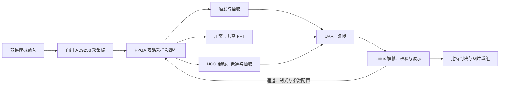

# 设计报告

## 背景与创新点

项目面向教学、信号调试和调制分析，把示波、频谱、幅相测量和图片传输演示放在同一套硬件上。常见方案可用 ADC 加软件处理，也可在 FPGA 内实现各条独立处理链。本项目在 XC7A35T 上复用 4096 点 FFT，组合多速率路径，并由 Linux 完成图形交互与选路判决。自制板使用商用 AD9238 芯片，原理图和 PCB 图在 board/hardware。

## 数据流与软硬件划分

| 环节 | 输入与处理 | 输出 |
|---|---|---|
| 采集 | 双通道模拟输入 → AD9238 → FPGA 并行接收、同步缓存 | 12 位、每通道 65 MSPS 原始样点 |
| 时域 | 采集缓存 → 触发及多档抽取 → RAW 帧 | 双路波形、频率和幅值。触摸可调两路触发 |
| 频域 | 选路及采样档位 → 加窗 → 4096 点共享 FFT → 谱峰和谐波带内功率统计 | 频谱及 H1–H5、THD2–5。Linux 另有 RAW 频谱 |
| 锁相与调制 | NCO 生成正交参考 → 乘法混频 → 低通、抽取 → I/Q | 幅度、相位、AM 包络、FM 频偏和 I/Q 观察 |
| 数字链 | Linux 按已知速率处理 OOK、2FSK 或 BPSK | 比特判决；图片模式按分包重组并校验 CRC |

FPGA 把握采样时序并降低串口传输量，Linux 负责交互、分包解码与状态展示。数据通过 AB5 送往屏端，AA5 接收配置。屏端根据回显确认配置，并结合 CRC、帧序与结果有效性判断显示。入口模块在 src/fpga/rtl/daq_top.v，具体格式以 src/fpga/rtl 和 src/linux/src 下对应收发实现为准。

## 优化与指标

| 项目 | 优化前或对照 | 交付版或实测 |
|---|---|---|
| LUT | 历史 1acb97f1 基线 18,877；首轮集成谐波候选 21,143，超器件容量 343 | a222905e 20,294 / 20,800，约 97.6% |
| DSP、BRAM | 首轮谐波候选 79 DSP、33 等效 BRAM | 80 / 90 DSP、36 / 50 等效 BRAM |
| 时序 | 候选阶段需分别核对 setup 与 hold | 已交付位流对应报告 WNS +0.172 ns、WHS +0.010 ns |
| 双通道交互 | 历史屏端触发只能操作单通道 | 11 月 12 日双通道触发与拖动实屏记录 |
| OOK 图片链路 | 接收选 CH2 时 0 包，发送端操作已完成 | 改屏端 CH1 后 32×64 收齐 8/8 包，整图 CRC32 32f70bed，包 CRC 错误 0 |

候选与交付版是不同构建快照。资源统计支持判断余量，不能单独量化某个 RTL 改动的贡献。实现报告在 build/fpga/evidence。采样率是 ADC 采集速率，UART 为 2 Mbaud。1024 是该位流的 RAW 每通道帧点数，4096 是 FPGA FFT 点数。

## 实测方法与验证边界

- **图片闭环**。发生器 CH2 输出 1 MHz 载波、OOK 1000 Bd，进入 FPGA ADC CH0，屏幕 CH1 完成判决、分包重组和 CRC。参考为原始 PBM 有效像素；记录含发生器回读、发送清单、屏幕截图及原设置恢复证据。该次屏端记录有 16 个重复包和 21 个 DSP gap。
- **相对频响**。在 250 kHz、500 kHz、1 MHz、2 MHz、4 MHz、5 MHz 六点测组合链路，以 1 MHz 归一化。观察值约为 −0.023 至 +0.052 dB，原始记录和统计在 data/relative_response_20261104。源系统误差未知，校正候选未在线启用。
- **谐波和触发**。11 月 12 日实屏记录包含谐波设置、结果页、双通道触发及两个频谱路径。THD 为二至五次谐波功率之和相对基波功率，缺少可溯源失真参考仪校准。
- **数字解调**。图片传输和已知速率判决按给定测试条件验收。QPSK 当前按 I/Q 观察描述。通用自动制式识别和完整 BER 验收仍待扩展。

## 大模型协作与技能提炼

report/llm-assisted-optimization-log.md 为历史协作与纠错记录，包含按当时工程状态描述的候选方案。早期提示词是复盘归纳。项目最终功能以上述版本与证据为准。此次提炼的 skill/ 串口工作流来自烧录瞬时输出、低帧率和图片发出但屏端 0 包等现象。每次先看原始字节，再看帧和配置，最后看业务结果，避免把发生器回读成功当作屏端成功。工作流含可复用 CRC 校验入口和本项目实测样本，适用边界见 skill/README.md。

完整构建、上板和复现操作见 [复现指南](reproduce.md)。

将输入 PBM 与实屏截图逐像素比较，抽取每个 6×6 显示像素块的中心，对应原图 2048 个像素，差异为 0。复跑命令为 python sim/compare_image_screen.py，依赖 Pillow。

## 功能框图

可直接定位的代码包括 ad9238_capture.v、multirate_fft_frontend.v、fft_frame_4ch.v、harmonic_stream_stats.v、ddc_nco_mixer.v、ddc_cic_decimator.v、ddc_fir_decimator.v 和 lockin_core_2ch.v。屏端接收和展示分别从 wave_source_v32.c、ui.c 进入，图片重组见 image_transport.h。
